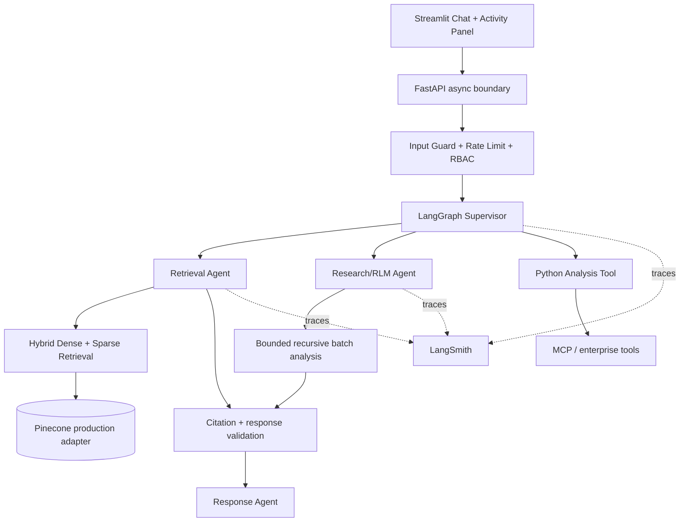

# Architecture

## State and failure containment
Every request owns an explicit graph state containing identity/role, intent, plan, evidence, analysis, events, validation and errors. A failed branch must not silently poison downstream state: errors are recorded, the supervisor can choose a fallback, and final generation only consumes validated evidence.

## Production vs POC
The repository runs offline with a deterministic lexical dense-proxy so evaluators can inspect orchestration without credentials. The production target replaces that adapter with Pinecone dense vectors + sparse/BM25 scores while preserving metadata/RBAC filtering and attribution.
